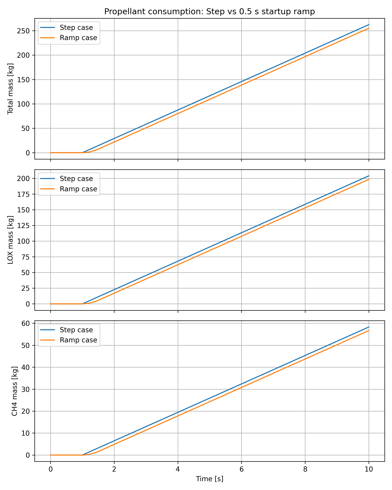
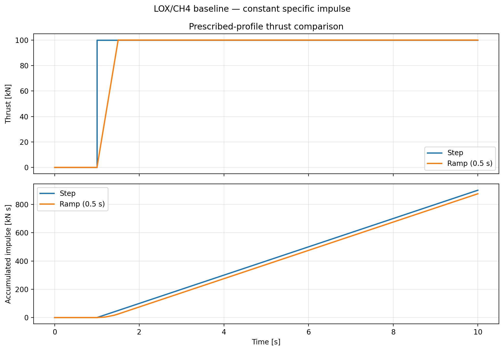

# Prescribed-Flow Baseline — Consumption, Thrust and Impulse

[Project overview](../../README.md) | [Component modelling](../components/README.md)

## Purpose

This baseline analyses the consequences of prescribed LOX/CH4 mass-flow histories.

A single Simulink model supports:

- instantaneous Step activation;
- a linear startup ramp followed by constant nominal flow.

The model calculates cumulative propellant consumption, thrust and accumulated impulse.

The purpose is to establish a simple reference with explicit assumptions and analytical checks. It does not predict physical engine startup dynamics.

## Reference figures

### Cumulative propellant consumption



### Thrust and accumulated impulse



## Files

| File | Role |
|---|---|
| `models/simulink/propellant_consuption_baseline.slx` | Baseline model |
| `scripts/matlab/setup_simulation.m` | Shared parameter initialization |
| `scripts/matlab/export_step_case.m` | Step simulation and export |
| `scripts/matlab/export_ramp_case.m` | Ramp simulation and export |
| `scripts/python/analyze_simulink_ramp.py` | Ramp consumed-mass analysis |
| `scripts/python/compare_step_and_ramp.py` | Consumed-mass comparison |
| `scripts/python/compare_thrust_and_impulse.py` | Thrust, impulse and final impulse–mass checks |
| `scripts/python/analyze_simulink_baseline.py` | Historical baseline analysis |

Paths in this document are relative to the repository root unless explicitly stated otherwise.

The model filename retains its original spelling.

## Requirements

- MATLAB and Simulink for simulation and export.
- Python dependencies from the root `requirements.txt` for analysis and tests.

See the [project overview](../../README.md#python-setup) for Python setup.

All commands below must be run from the repository root.

## Nominal configuration

| Parameter | Value |
|---|---:|
| Nominal thrust input | 100000 N |
| Specific impulse input | 350 s |
| Standard gravity | 9.80665 m/s² |
| Oxidizer-to-fuel mass ratio | 3.50 |
| Simulation start time | 0 s |
| Simulation stop time | 10 s |
| Flow activation time | 1 s |
| Ramp duration | 0.5 s |
| Total nominal mass flow | 29.134749 kg/s |
| LOX nominal mass flow | 22.660360 kg/s |
| CH4 nominal mass flow | 6.474389 kg/s |

The thrust and specific impulse values are prescribed inputs. They are not performance predictions from a coupled physical engine model.

No ambient-pressure condition is specified for the 350 s specific impulse input; it should not automatically be interpreted as sea-level performance.

The setup script calculates:

```text
Total flow = thrust / (specific impulse × standard gravity)

LOX flow = total flow × O/F / (1 + O/F)

CH4 flow = total flow / (1 + O/F)
```

## Model initialization and profile selection

The model initializes through its `InitFcn` callback.

The callback resolves the project root from the model location and runs:

```text
scripts/matlab/setup_simulation.m
```

Each total, LOX and CH4 flow branch contains:

- a Step source;
- a Ramp source followed by a Saturation block;
- a Switch selecting the signal supplied to the mass integrator.

The common Constant block `Profile selector` controls all branches.

| Value | Profile |
|---|---|
| `0` | Instantaneous Step |
| `1` | Linear startup ramp |

The Switch condition is `u2 >= 0.5`.

The saturated ramp is connected to the first input and the Step signal to the third input.

The export scripts select the profile using `Simulink.SimulationInput`, so manual switching is not required.

The shared initialization currently prints analytical ramp masses for both profiles. For the Step case, use the profile-specific results printed by the Step export script.

## Regenerating simulation exports

From the repository root in MATLAB:

```matlab
run("scripts/matlab/export_step_case.m")
run("scripts/matlab/export_ramp_case.m")
```

| Profile | Export |
|---|---|
| Step | `results/matlab_simulink/step_export.mat` |
| Ramp | `results/matlab_simulink/ramp_export.mat` |

Both exports include:

- cumulative total, LOX and CH4 consumed masses;
- nominal mass-flow rates;
- thrust time and thrust series;
- impulse time and accumulated-impulse series;
- nominal thrust, specific impulse and standard gravity;
- profile timing parameters.

The ramp export also includes the ramp duration.

The Step profile label is exported as a MATLAB character array for compatibility with the Python/SciPy loading workflow.

### Checks before saving

The Step export script checks:

- final mass-signal simulation time;
- final total, LOX and CH4 consumed masses;
- mass balance across the exported series;
- final accumulated impulse.

The ramp export script checks:

- positive ramp duration and ramp completion before simulation end;
- final times of mass, thrust and impulse signals;
- final consumed masses;
- matching mass-array dimensions;
- mass balance;
- maximum thrust;
- final accumulated impulse.

After changing model parameters or structure, regenerate the relevant exports before analysis.

## Analytical references

The mass references assume zero initial consumed mass and non-negative nominal mass flow.

The plotted masses are cumulative consumed propellant, not propellant remaining in tanks.

### Instantaneous Step

```text
Consumed mass at time t =
nominal flow × max(t − t_activation, 0)
```

For simulation end after activation:

```text
Final consumed mass =
nominal flow × (t_stop − t_activation)
```

### Linear startup ramp

For a ramp that finishes before simulation end:

```text
Final consumed mass =
nominal flow × (t_stop − t_activation − ramp_duration / 2)
```

The expressions are applied separately to total propellant, LOX and CH4.

### Thrust and impulse

With constant specific impulse:

```text
Thrust =
total mass flow × specific impulse × standard gravity
```

Final impulse references:

```text
Step impulse =
nominal thrust × (t_stop − t_activation)

Ramp impulse =
nominal thrust × (t_stop − t_activation − ramp_duration / 2)
```

The final impulse–mass relation is:

```text
Final impulse =
total consumed propellant × specific impulse × standard gravity
```

This relation provides an internal-consistency check under the same assumptions, not an independent experimental validation.

## Python analysis

Activate the Python environment before running these commands.

### Ramp analysis

```powershell
python scripts/python/analyze_simulink_ramp.py
```

Reads the ramp export, checks mass balance and analytical final masses, and creates:

```text
results/figures/propellant_mass_ramp_python.png
```

### Consumed-mass comparison

```powershell
python scripts/python/compare_step_and_ramp.py
```

Reads the Step and ramp exports, checks their mass balances, prints final consumed masses and creates:

```text
results/figures/step_vs_ramp_mass_comparison.png
```

### Thrust and impulse comparison

```powershell
python scripts/python/compare_thrust_and_impulse.py
```

The script checks:

- required exported variables;
- matching nominal thrust, specific impulse, gravity and timing parameters;
- thrust and impulse array lengths;
- finite values and time ordering;
- expected simulation interval;
- analytical final impulses;
- final impulse–consumed-mass consistency.

It also prints equivalent specific impulse and creates:

```text
results/figures/step_vs_ramp_thrust_impulse.png
```

Each signal is plotted against its own exported time vector.

These scripts read existing exports. They do not run or regenerate MATLAB simulations.

## Reference results

| Quantity | Step | 0.5 s startup ramp |
|---|---:|---:|
| Total propellant consumed | 262.2127 kg | 254.9291 kg |
| LOX consumed | 203.9432 kg | 198.2782 kg |
| CH4 consumed | 58.2695 kg | 56.6509 kg |
| Maximum thrust | 100000 N | 100000 N |
| Final accumulated impulse | 900000 N·s | 875000 N·s |
| Equivalent specific impulse | 350 s | 350 s |

Both profiles activate at 1 s and stop at 10 s. The ramp reaches nominal flow at 1.5 s.

The total consumption difference is approximately 7.2837 kg, calculated using unrounded results.

The ramp reduces both propellant consumption and accumulated impulse by approximately 2.777778% over this interval.

This is not evidence of improved propellant efficiency: the cases deliver different impulses.

## Automated verification

Run all existing tests:

```powershell
python -m pytest tests
```

Run the dedicated profile tests:

```powershell
python -m pytest tests/test_step_case.py -v
python -m pytest tests/test_ramp_case.py -v
```

### Step checks

The dedicated Step tests cover:

- profile label;
- finite, non-decreasing times and expected interval;
- consistent time-series lengths;
- finite masses and nominal flows;
- non-negative and non-decreasing consumed masses within tolerance;
- mass balance;
- complete mass-curve agreement with the analytical Step solution;
- nominal mass-flow balance;
- O/F ratio of 3.5.

The previously recorded dedicated Step-test run passed all 11 tests. This is a historical result, not a statement that tests have been rerun after every modification.

### Ramp checks

The dedicated ramp tests cover:

- required exported variables;
- consistent time-series lengths;
- non-decreasing consumed masses within tolerance;
- mass balance;
- analytical final masses;
- nominal O/F ratio of 3.5;
- ramp duration of 0.5 s.

### Verification boundaries

The thrust–impulse and final impulse–mass checks are implemented in the comparison script and MATLAB exports. They should not be assumed to be additional pytest tests.

Passing checks on saved data does not establish that the data came from the latest model revision.

The component test benches are not covered by these baseline tests.

## Historical baseline

The retained historical dataset is:

```text
results/matlab_simulink/baseline_export.mat
```

It is not overwritten by the Step export script.

Run its analysis with:

```powershell
python scripts/python/analyze_simulink_baseline.py
```

The script checks mass balance and creates:

```text
results/figures/propellant_mass_balance_python.png
```

The current Step–ramp comparisons use the separate Step and ramp exports, not this historical file.

## Limitations

- Startup profiles are prescribed, not predicted.
- Specific impulse is constant.
- No detailed ignition or shutdown process is represented.
- Equal simulation duration does not imply equal delivered impulse or mission performance.
- The mass-comparison script does not yet enforce all cross-case parameter checks.
- The separate thrust–impulse script checks its required nominal parameters and timing.
- Some tests intentionally require the reference O/F ratio and ramp duration.
- Python analysis does not automatically regenerate exports.
- No experimental engine validation is claimed.

## Future work

- Automatically enforce matching parameters in the consumed-mass comparison.
- Separate shared initialization from profile-specific console output.
- Add a single entry point for simulation regeneration and analysis.
- Add continuous integration for checks using committed exports.
- Extend analytical checks to additional activation times and ramp durations.

## Relationship to component modelling

The nominal LOX flow is used as a sizing target for the standalone LOX restriction test bench.

The component models are not yet connected to this baseline. In particular, the prescribed ramp is not generated by a valve or injector model.

See the [component documentation](../components/README.md).